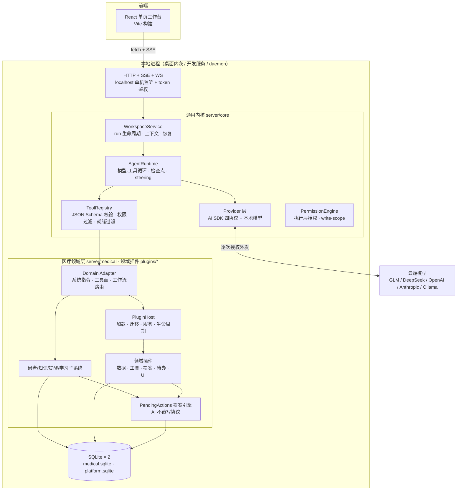

# Open Medical 架构说明 · 1.0.0

面向开发者与代码审阅者的系统架构。使用入门见 [README](../README.md)，医生使用流程见 [医生使用指南](DOCTOR_WORKBENCH_GUIDE.md)。

医生界面、AI 复核、患者上下文及任务验收遵循 [开发指南](DEVELOPMENT_GUIDE.md)；该指南区分研究依据、项目要求和待验证的设计假设。

---

## 1. 总览

**一个 Node.js 进程 = HTTP/SSE 服务 + SQLite + Agent 运行时。** 无服务端依赖、无外部数据库、不监听公网。医疗业务与通用 Agent 能力分层共存：通用内核不知道"患者"是什么，医疗层以领域适配器（Domain Adapter）形式挂载。



**三条不变量**（理解本项目的钥匙）：

1. **AI 不直写**：模型侧一切数据变更只能提交类型化提案（`pending_actions`），医生确认后在事务内由确定性代码应用。UI 侧与 AI 侧最终调用同一批服务方法——"AI 写的"和"人写的"走完全相同的校验与审计路径。
2. **确定性外壳 + 概率内核**：凡判断（分组、统计、风险规则、患者归属、检索排序）均为纯本地确定性代码；模型只负责自然语言 ↔ 结构化的翻译与起草。
3. **本地数据主权**：全部状态在本机 SQLite；密钥经本地凭据库加密；模型外发逐次授权、仅含当轮所需材料。

## 2. 进程与运行形态

| 入口 | 命令 | 说明 |
| --- | --- | --- |
| 开发服务 | `npm run dev:server` → `server/agent.mjs --dev-web` | 医疗全功能，`127.0.0.1:8787`，数据在 `server/data/medical.sqlite` |
| 通用平台 | `npm run platform` → `server/platform.mjs` | 无界面 API，同一内核、不加载医疗层/患者表，`8788`，独立数据库 |
| 桌面端 | `npm start` / `npm run desktop` → `desktop/main.cjs` | Electron 壳内嵌同一 `createServer`（随机端口、桌面数据目录）；仅原生窗口可取得界面与会话凭据，禁代理 |
| 后台守护 | `npm run daemon` | 独立通用任务的后台 API（端口 + 指纹校验）；不接管桌面医疗任务 |
| 独立 CLI | `npm run workspace` | 不依赖医疗服务器的通用工作区命令行 |

HTTP 面统一经 `guard()`：localhost Host 校验 + 同源 + 启动时生成的随机 token（`X-Medical-Token`）。鉴权豁免仅限自带签名/密钥的回调端点（企微回调、ingest）。

## 3. 内核层（`server/core/`）

### 3.1 AgentRuntime（`agent-runtime.mjs`）——显式轮次循环

每轮：**steering 摄入 →（审批恢复检查）→ 权限过滤工具面 → 上下文预算裁剪/压缩 → `provider.complete()` 流式 → 解析 tool_calls → 逐工具：authorize → 预算记账 → `domain.beforeTool` → 执行 → 观察回执 → checkpoint → 下一轮**，至无工具调用或预算耗尽；`domain.verifyDelivery` 可打回"声称完成但无产物"的假完成（上限两次）。

- **观察回执（observations）**：每次 `read_source` 类工具记录 `{工具, 参数, revision: hash, 读取范围}` 进 `runtimeState`——"模型看过哪些原文"的审计账本，引用校验与断链告警都以它为准。
- **检查点**：每轮将 `contextMessages + runtimeState` 序列化入事件库；崩溃/中断后按 `resumeRunId` 从检查点重建，不重放模型调用。
- **steering**：运行中用户输入经 `takeInput()` 在轮次间隙注入并重置规划；运行前输入即 `run.inputs` 持久队列。
- **截断续轮**：`stopReason: max_tokens` 时自动携带已有输出续写。

### 3.2 WorkspaceService（`workspace-service.mjs`）——运行编排

- `prepare()` 五重校验：活跃 run 锁（每工作区 1 个、全局 3 个）、容量、`revision` 乐观锁、模型同意、`requestId` 幂等。
- **contextIdentity**：模型配置 + 领域系统提示的哈希。跨 run 上下文复用、检查点恢复、归档访问都以它鉴权——配置一变，旧上下文自动作废。
- **两条记忆策略**：非患者会话默认链式继承先前 run 的 `contextMessages`（常驻助手靠它获得跨轮记忆）；患者问答按 `conversationParentRunId` 只回放可见对话（问题间隔离，`shared/patient-conversations.mjs`）。
- **产物收集**：`collectArtifacts` 从工具输出抓取带 `id` 的结构化草稿（`treatment_review`、`similar_cases` 等），进入会话复核流——这是"AI 不直写"在内核侧的实现：模型只能产出草稿对象。
- 状态机 `queued/running/waiting_approval/waiting_input/blocked/cancelled/failed/interrupted/completed`，转换受 `run-status.mjs` 约束；进程重启将遗留 `running` 标记 `interrupted`。

### 3.3 工具与权限

- `ToolRegistry.register({definition, execute, permission, capability, observation})`；`definitions(permissionEngine)` 按**运行时授权**过滤模型可见面，另经 `readinessFilter` 剔除后端不可用的工具（探测按配置身份 + TTL 缓存）——模型看不见未授权或注定失败的工具。
- 参数按声明的 JSON Schema 校验（拒未知属性/类型错误/超限）。
- **write-scope**（`write-scope.mjs`）：文件写路径白名单、符号链接拒绝、越界即拒；文件审批（提案 → diff → 应用/回滚）建立其上。
- **代码模式**（`code-mode.mjs`）：在隔离 Node 容器内用 JavaScript 编排已授权工具（32 次调用/8 并发），无递归。
- **Python 沙箱**（`python-sandbox.mjs`）：macOS Seatbelt 默认拒绝（禁网/禁写/禁子进程），资料经 stdin 传入、密钥不进环境；不支持平台**失败关闭**。边界详见 [ORCHESTRATION](ORCHESTRATION.md)。

### 3.4 Provider 层（`ai-sdk-provider.mjs`）

统一模型入口，基于 `@ai-sdk/{anthropic, openai, deepseek, openai-compatible}` 四协议包 + 本地 OpenAI 兼容端点。职责：流式增量归一、Anthropic thinking 块透传、截断标记、厂商错误翻译为稳定错误码。模型配置链：**预设（`shared/model-presets.mjs`）→ 协议 → baseUrl → 密钥**；密钥经 CredentialVault（`oauth.mjs`，本机 32 字节 key 文件 0600、拒绝符号链接，加密存 SQLite）。嵌入服务（知识库向量化）与主模型独立配置。

### 3.5 调度与恢复

`workspace-scheduler.mjs`：SQLite 持久队列（单次/间隔/cron 含时区），错过窗口合并执行、失败暂停留痕不静默重放；独立于浏览器连接。`workspace-recovery` + `trajectory-replay` 提供重启恢复与轨迹回放。

## 4. 数据层

### 4.1 存储布局

| 库 | 主要表 |
| --- | --- |
| `medical.sqlite` 固定区（`store.mjs`） | `patients`、`patient_messages`、`reminders`、`appointments`、`pending_actions`、`doctor_profile/doctor_memories`、`guideline_docs/chunks/chunk_vectors`、`sessions`、`event_log`、`audit`、`context_archives`、`meta` |
| 插件表（每个插件自己的迁移/`legacyTables`） | 宿主元数据 `plugin_migrations`、`plugin_state`、`plugin_config`；各插件表族例如 `follow_ups`/`followup_*`/`chat_*`/`care_*`（followup）、`care_tasks`（care-tasks）、`risk_alerts`/`lab_*`（risk-rules）、`trial_*`（trials）、`message_*`（channel）、`wecom_*`（channel-wecom）、`wechat_*`（channel-wechat）、`doctor_notification_*`、`learning_*` |
| 通用内核（`workspace-store.mjs`，随宿主库建表） | `agent_workspaces`、`agent_events`、`agent_context_archives`、`agent_trace`、`agent_run_history`（每工作区保留最近 50 run，更早归档） |

### 4.2 模式与一致性

- 模式为「JSON blob 列 + 查询热路径 SQL 化」：如 `patients(id, data)` 整档 JSON，名单/计数走 `json_extract` 投影（`summaries()` 在 SQL 内重组，不传输全量病历）。
- WAL、`BEGIN IMMEDIATE` 事务（可重入嵌套，`sqlite-transaction.mjs`）、参数化语句、0600 文件权限。
- **单进程文件锁**：锁文件记录 pid+随机 id，启动检测存活进程，重复启动直接拒绝。
- 患者更新走 `revision` 乐观锁；提案带 `base_revision` 基线，"生成提案后档案被改过"在确认时被 409 拦截。
- 备份：`VACUUM INTO` 一致性快照（`medical/backups.mjs`），保留最近 14 份、同秒序号避让；状态从目录文件真值推导。

## 5. 医疗领域层（`server/medical/` + `plugins/`）

### 5.1 领域接入（`medical-workspace-domain.mjs`）

`defineDomain({systemFor, registerTools, runSystemExtras, beforeTool, finalizeResult, verifyDelivery, …})` 挂入 WorkspaceService。**单一判定点** `medicalWorkspaceEnabled()`（`kind === "session"` 或 `modeFlags.medical`）同时控制系统指令与工具面——两者不可能半开。`registerTools` 先注册固定区工具，再调用 `pluginHost.registerTools(...)` 注册启用插件的工具；`systemFor` 末尾追加 `pluginHost.promptFragments()`。按 `run.policy.workflow` 的门控分两类：

| 工作流 | 归属 | 工具面处理 |
| --- | --- | --- |
| `patient-assessment` | 固定区 | 白名单外工具全部删除；文献检索限 2 次、联网搜索限 3 次（execute 计数包装）；草稿必须引用本轮实际读取的行范围（引用校验回放观察账本） |
| `patient-intake` | 固定区 | 建档工具 + 材料快照，断点续传 |
| `global-assistant`（全局助手） | 固定区 | `list_patients` / `read_patient_chart` / `patient_scan` / `patient_stats`（确定性遍历+结构化条件，不逐患者调模型）/ `followups_overview` / `patient_grouping_propose` + 知识库检索 |
| `similar-case-search` | `similar-cases` 插件 | 插件 `workflows.configure` 裁剪工具面，本地病例 + 在线病例报告；插件停用返回 409 |
| `trial-eligibility` | `trials` 插件 | 插件注册纳排逐条核对工具 |
| `literature-research` | `literature` 插件 | 插件校验引用证据，`beforeComplete` 可打回无依据的回答 |

消息路由在 `session-bridge.mjs` 的 `prepareSend`：`medicalPolicy()` 正则意图分类 → 显式 `workflow`（患者页一键入口）覆盖正则 → policy 随 run 持久化。全局助手是 `modeFlags.global` 的单例 session，上下文默认链式（跨轮记忆）。

### 5.2 提案引擎（`pending-actions.mjs`）——"AI 不直写"的落点

```
模型调用 *_propose 工具（结构化 payload）
  → propose()：类型白名单 → 固定区家族归一化校验，或委派 pluginHost.proposalHandler(kind)
      → 快照基线（base_revision / 患者名单 / 分组现状）
  → INSERT pending_actions (status=pending)
  → 医生在托盘或档案页 confirm / reject
  → confirm()：单个事务内：状态检查 → 归档检查 →（单患者类）revision 乐观锁
      → 按类型分发：固定区 apply，或插件 validate/apply（同一个 sqliteTransaction）
      → 任何一步失败整体回滚
```

插件停用或不可用时，历史提案仍可列表（`knowsProposalType`），但确认返回 409 `PLUGIN_UNAVAILABLE`。插件接管的历史 type 使用 `legacyProposalTypes`，数据库字符串和旧 payload 形状保持不变。

处置语义：已确认/拒绝的提案在**证据不变**时不被重复执行或自动重开；证据变化（新检验、新档案版本）才重开要求复核。多患者提案（如分组）逐人按当前态校验：已在组=幂等成功，归档/超额=跳过并报告。

### 5.3 子系统速览（原理一句话 + 入口文件）

| 子系统 | 原理 | 入口 |
| --- | --- | --- |
| 患者档案 | JSON 整档 + revision 乐观锁；身份校验防同名误合并 | `patients.mjs` |
| 诊前速览 | 确定性本地读模型（诊断/用药/检验分组去重、冲突标注），零模型调用 | `patient-brief.mjs` |
| 材料摄取 | 浏览器 PDF.js 解析（≤20MB/300 页，只存抽取文本）；OCR 三级回退：macOS Vision（Swift 辅助，无网无截屏权限）→ Windows.Media.Ocr → 视觉模型；转写质量评分，低分自动升级复核 | `materials.mjs`、`core/image-ocr.mjs` |
| 知识库 | 原文件+正文+分块索引三层；资料类型决定提取规则（指南→推荐意见，说明书→禁忌剂量…）；引用带行号，覆盖率/复核状态分立 | `guidelines.mjs`、`knowledge-*.mjs` |
| 向量检索 | LanceDB 本地列存；嵌入默认 bge-m3 云端（仅公开知识出网）可切 Ollama 离线；未配嵌入时关键词兜底；关键词+向量混合打分 | `vector-store.mjs`、`embeddings.mjs` |
| 知识图谱 | LLM 按资料类型提取带行号引文的节点/边，断点续传；前端自研力导向布局（螺旋初始化 + 斥力/弹簧/退火，确定性输出）+ SVG | `knowledge-graph.mjs`、`src/knowledge-graph-model.mjs` |
| 检验引用 | 同名项目不同单位/参考区间分开保留不换算；表格引用可定位到行 | `knowledge-tabular.mjs` |
| 风险规则 | 纯本地阈值/趋势/监测规则（单位归一化后匹配）；档案更新即重算；不再触发自动 resolve；医生处置在证据不变时不被覆盖 | `plugins/risk-rules/server/risk-rules.mjs` |
| 随访 | 状态机 + `next_due`；到期生成 reminder **不算完成**，联系结果单独登记可更正；失败暂停留痕；需要至少一个已连接渠道才激活 | `plugins/followup/core/followups.mjs` |
| 消息渠道 | 插件注册表（声明 capabilities）；企微官方长连接 wss；微信 Windows 本机 OCR 读屏 + 发送三重视界校验（任何校验不过不发送不重试）；导出文件手写 RFC-4180 解析（拒畸形引号/路径穿越/zip 上限） | `plugins/channel/`、`plugins/channel-wecom/`、`plugins/channel-wechat/` |
| 患者归属 | 确定性匹配：绑定备注名 > 精确同名；同名必须人工指派，绝不模糊归档 | `plugins/followup/core/chat-followups-api.mjs` |
| 红旗规则 | 确定性规则在模型调用**前后双重执行**，模型可加谨慎措辞但不能否决 | `plugins/followup/core/care/red-flags.mjs` |
| 学习闭环 | 显式偏好→待确认记忆；采纳/修改/驳回信号→候选（重复出现才升级）；每次任务展示"本次采用的偏好" | `plugins/learning/server/habit-learner.mjs`、`server/medical/doctor-profile.mjs` |
| 试验纳排 | 规则预筛（年龄/性别/诊断关键词）→ 批量 AI 初筛（后台 job）→ 医生逐条核对；AI 结果只是草稿 | `plugins/trials/server/trial-*.mjs` |
| 相似病例 | 本地病例库确定性相似度 + PubMed/Europe PMC 在线病例报告；脱敏指纹出网 | `plugins/similar-cases/server/similar-case-workflow.mjs`、`case-comparison.mjs` |
| 今日待办 | 固定区只读聚合：复诊 + 待阅检验 + 启用的插件来源；合并/排序/分页/计数由壳负责 | `server/medical/doctor-overview.mjs` |
| 全局助手统计/扫描 | 结构化条件确定性遍历（诊断关键词+时间窗、检验阈值+最近值、年龄段），统计分母口径显式（未查该项目不计入） | `patient-scan.mjs`、`patient-stats.mjs` |
| 示例患者包 | 固定标签虚构患者，幂等装载/整包删除，真实档案不触碰；插件通过 `demo` 钩子装卸自己的示例 | `demo-pack.mjs` |
| 医生提醒 | 微信医生号/飞书 Webhook 每日摘要；摘要不含患者姓名与病历内容 | `plugins/doctor-notifications/server/doctor-notifications.mjs` |
| 技能 | 目录扫描 `SKILL.md`（元数据+正文），仅注入为模型说明书，无执行语义 | `core/skills.mjs` |
| 扩展中心 | 自然语言 → `matches(patient, condition)` 确定性试算 → 提案确认固化为技能/自动化规则（事件总线求值），可回滚 | `extensions.mjs` |
| MCP | 标准 MCP 客户端，OAuth 凭据入 vault | `core/mcp-client.mjs` |

## 6. 领域插件

### 6.1 宿主与加载流程

领域插件是“固定区之外的医疗场景”的唯一扩展方式：一个目录同时携带数据迁移、服务、Agent 工具、提示/技能、提案、待办来源、HTTP 路由和前端插槽组件。宿主在 `server/plugin-host/`：

- `define.mjs`：`definePlugin(spec)` 校验并冻结声明（id/version/title、依赖、迁移前缀、提案、路由、生命周期等），坏声明在加载阶段失败，不会污染运行中的服务。
- `host.mjs`：`PluginHost` 负责扫描、依赖解析、迁移、setup、工具注册、提示/技能拼接、提案委派、待办聚合、API 分派、启停与状态汇报。

启动顺序（`server/agent.mjs` 的 `createServer`）：

1. **扫描** `pluginDirs`（默认 `plugins/`；测试可注入单个插件目录或容器目录）。
2. **`load()`**：读取 `plugin.mjs` → `definePlugin` 再校验 → 读取 `prompt.md`/检查 `skills`/`migrations` 目录 → 解析 `requires.plugins` / `requires.anyOf`（缺依赖、版本不满足、依赖环 → `unavailable`，服务照常启动）。
3. **`migrate()`**：按插件依赖顺序执行未应用的 `.sql`，每个文件一个事务；校验所有新表/索引属于 `tablePrefix`，记录到 `plugin_migrations`。
4. **`setup()`**：按拓扑顺序调用 `setup(ctx)`，把返回值放入 `services[id]`；注册 `provides.service`、`events`、`hooks`；检测 `legacyApiPaths` 冲突（冲突插件 `unavailable`）。
5. **`startAll()`**：解析 `status`/`activation`，按拓扑启动 `lifecycle.start`；dormant 插件不启动。
6. **接入固定区**：`registerTools` 注册工具；`promptFragments()`/`skillDirs()` 注入提示与技能；`agendaSources()`/`agendaItems()` 供今日待办；`patientSummaries()`/`patientBrief()` 供患者列表与简报；`handleLegacyApi()`/`handleApi()` 在鉴权后分派；`/api/bootstrap` 返回 `plugins`。
7. **关闭**：`stopAll()` 逆序停止，`drainAll()` 等待在途工作（默认 5 秒超时），不阻塞退出。

运行时启停（设置页 `PUT /api/plugins/:id`）会更新 `plugin_state`、重新计算路由、按需 `stop/start`；前端在 bootstrap 更新后重新注册 UI，无需刷新页面。

### 6.2 生命周期与失效隔离

- **enabled**：`plugin_state` 或 `enabledByDefault`。停用 = 不注册工具、不返回待办、API 404、业务插槽不渲染；数据保留。
- **available**：加载/迁移/setup/依赖/路由冲突任一失败即为 `unavailable`，`reason` 说明原因；其它插件和固定区继续工作。
- **active**：`enabled && available`，且满足 `activation.requiresConnection` 的 `status` 连接条件。dormant 插件仍保留连接设置面板（`availableWhenDormant`）。
- **历史数据**：停用插件的旧提案仍可列表，旧 artifact 仍可读，患者删除钩子仍执行清理。

### 6.3 固定区与插件的边界

| 固定区负责 | 插件负责 |
| :--- | :--- |
| 对话入口、患者上下文、权限/审计、提案确认托盘 | 场景自己的表、服务、工具、提示、提案处理 |
| 患者档案、复诊预约、知识库、知识图谱、设置壳 | 专科页面、工具目录卡片、结果卡片、设置面板 |
| 今日待办的合并/排序/分页/计数 | 通过 `agendaSources` 提供事项 |
| 患者列表/简报的稳定字段 | 通过 `patientSummary`/`patientBrief` 贡献计数与摘要 |
| 跨插件共享的布局 CSS 与基础组件 | 仅插件专用的选择器与组件 |

固定区不得直接读写插件表；跨边界只能走 `ctx.service()`、`patientSummary`/`patientBrief`、`agendaSources`、事件或 `hooks`。

### 6.4 插件清单与职责

`plugins/` 当前有 15 个可加载插件；另有 1 个已撤销的过渡插件 `legacy-agenda`（T10c 把“我的规则”来源并入 `learning` 后删除 `plugin.mjs`，T11c 清理空目录），合计 16 个插件目录的最终去向。

| 插件 | 职责 |
| :--- | :--- |
| `care-tasks` | 检查复查与转诊跟进：`care_tasks` 表、`tracking` 待办、患者页“检查与转诊”tab、转诊/结果跟进 API。 |
| `channel` | 消息渠道基础：`channel.adapters` 契约、`message_*` 表、渠道注册与旧 `/api/message-channels` 路由。 |
| `channel-wechat` | 个人微信：wx-cli、桌面读取/导入导出、已退役 bridge、`wechat_*` 表与旧 `/api/wechat*` 路由。 |
| `channel-wecom` | 企业微信：连接器、通讯录/客户/群、客服与智能机器人、会话存档、`wecom_*` 表与旧 `/api/wecom/*` 路由；客户/群工具提示。 |
| `clinical-ref` | 临床速查：量表、检验参考、ICD-9/10、不良反应，工具目录卡片与 `legacyViews` 页面。 |
| `doctor-notifications` | 医生提醒：微信医生号/飞书 Webhook 每日摘要、设置面板；摘要不含患者姓名与病历内容。 |
| `drg` | DRG 示例测算：分组规则、示例费率、`legacyViews` 页面与测算 API。 |
| `feishu-knowledge-bot` | 飞书知识库机器人：知识库问答、消息回执、`knowledge_bot_*` 表与设置面板；依赖知识库能力。 |
| `followup` | 随访与患者消息：计划/问卷、聊天随访、自动随访、企微机器人业务层、care 引擎、`follow_*`/`followup_*`/`chat_*`/`care_*` 表、`followup`/`messages` 待办、患者页沟通 tab、7 个历史提案 type、旧随访/care 路由；需至少一个已连接渠道才激活。 |
| `learning` | 学习与规则：医生习惯/记忆候选、自动化规则、专科模板包、`review_*`/`habit_*`/`learning_*`/`workbench_*`/`automation_*`/`evolution_*` 表、设置面板与 `custom` 待办来源。 |
| `legacy-agenda`（已撤销） | 过渡期的待办来源集合；各 kind 已迁入 `followup`、`risk-rules`、`trials`、`care-tasks`、`learning`，目录在 T11c 删除。 |
| `literature` | 文献研究：PubMed/Europe PMC 检索、文章导入会话材料、证据校验工作流、`legacyViews` 页面与旧 `/api/literature/*` 路由。 |
| `research-stats` | 科研统计与脱敏导出：描述统计、组间比较、样本量、脱敏 CSV；`legacyViews` 与工具卡片。 |
| `risk-rules` | 风险规则：阈值/趋势/监测规则、`risk_alerts`/`lab_*` 表、`risk` 待办、患者简报风险计数与旧 `/api/risk*` 路由。 |
| `similar-cases` | 相似病例：本地病例库确定性相似度、在线病例报告、`similar-case-search` 工作流、`similar_cases` 结果卡片。 |
| `trials` | 临床试验入组：方案库、规则预筛、批量 AI 初筛 job、医生核对/入组提案、`trial_*` 表、`trial` 待办与工具卡片。 |

### 6.5 前端插槽

固定区在 `src/plugin-slots.jsx` 定义 9 个插槽：`patient.tabs`、`patient.overviewCards`、`patient.actions`、`agenda.sources`、`chat.resultCards`、`proposal.renderers`、`settings.panels`、`tools.directory`、`legacyViews`。插件 `ui/index.jsx` 用 `defineUiPlugin` 声明贡献；宿主 eager 收集入口、组件 `React.lazy` 懒加载，每个贡献独立 `Suspense + ErrorBoundary`，空插槽不产生 DOM。停用/未激活插件不渲染业务插槽；历史 artifact 和旧 URL 分别走 `ResultCard` fallback 与 `LegacyView` fallback。

## 7. 前端（`src/`）

React 19 单页（无路由库，URL query 状态机 `navigation.js`），Vite 构建。通信统一 `agent-runtime.js`：`bootstrap()` 取 token → `api()` fetch 封装（401 自动重取）→ `streamTurn()` POST + SSE 帧解析（`shared/sse.mjs`，UTF-8 分片安全）。关键面：首页驾驶舱（数字卡 + 今日名单 + 待确认预览行内确认）、任务工作区（会话/流式/步骤流/产物复核）、患者页（多页签 + 材料阅读区）、知识库（入库→审核→证据）、全局助手（单例会话）、命令面板（Cmd+K）。设计令牌单一出处（`style.css :root`，muted 对比度 ≥4.5:1）。

## 8. 安全模型（分层）

| 层 | 机制 |
| --- | --- |
| 传输 | 仅 localhost 监听 + 随机 token + 同源校验 |
| 数据 | 本机 SQLite（0600/WAL/单进程锁）；密钥本地加密；`VACUUM INTO` 快照备份 |
| 模型外发 | 逐次同意；仅当轮所选材料；计划任务/自动总结需单独重复授权；嵌入仅公开知识、可全离线 |
| 工具 | 权限过滤 + JSON Schema 校验 + write-scope + 沙箱失败关闭 |
| 临床 | AI 不直写（提案协议）；红旗规则前后双重执行；引用可溯源；输出默认"待复核、不替代医生判断" |
| 审计 | append-only 事件/轨迹表；删除患者级联删除其工作区（不影响已导出文件与备份） |

已知边界（如实声明）：本地审计未实现签名链/防篡改；患者库本身未加密（靠文件权限与整机加密）；微信读取依赖第三方客户端行为；临床有效性未验证。

## 9. 模块地图

```
server/
  agent.mjs            医疗组合根：路由 + 各子系统装配 + token
  platform.mjs         通用平台组合根（无医疗）
  session-bridge.mjs   会话路由/工作流分类/材料快照
  core/                通用内核（AgentRuntime、WorkspaceService、Provider、权限、调度、沙箱、MCP…）
  medical/             医疗领域层（领域适配、提案、患者、知识、提醒、学习、统计…）
  plugin-host/         领域插件宿主（define 校验 + 加载/迁移/服务/路由/生命周期）
  chat-connectors/     渠道连接的通用底层原语（注册表、可见文本差分、归档端点）
  domains/             通用 domain 适配
plugins/               领域插件（每个目录 = 一个场景：数据/工具/提案/待办/UI）
desktop/               Electron 壳（主进程、权限辅助、原生桥）
shared/                前后端共用（policy、SSE、诊断结构、患者问答链、模型预设…）
src/                   React 前端（插槽宿主与固定区）
skills/                内置医疗技能（SKILL.md 工作流说明书）
docs/plugin-template/  最小插件模板（不参与加载）
scripts/new-plugin.mjs 插件脚手架（npm run plugin:new）
```
