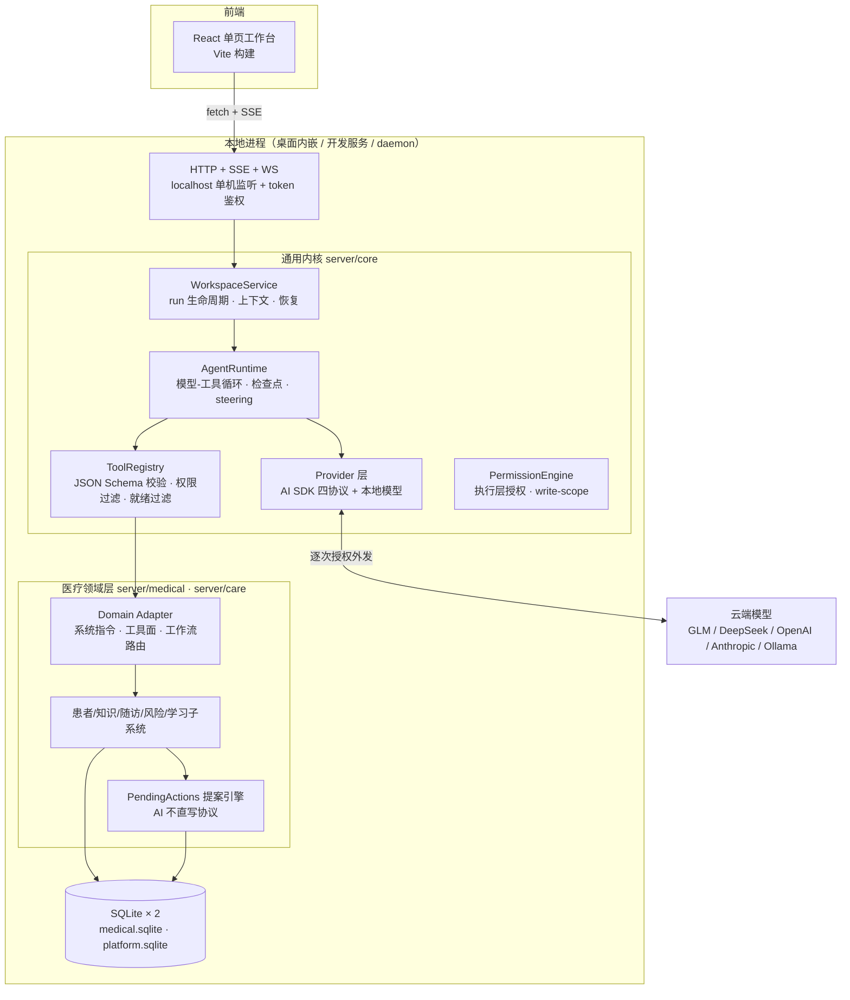

# Open Medical 架构说明 · 1.0.0

面向开发者与代码审阅者的系统架构。使用入门见 [README](../README.md)，医生使用流程见 [医生使用指南](DOCTOR_WORKBENCH_GUIDE.md)。

---

## 1. 总览

**一个 Node.js 进程 = HTTP/SSE 服务 + SQLite + Agent 运行时。** 无服务端依赖、无外部数据库、不监听公网。医疗业务与通用 Agent 能力分层共存：通用内核不知道"患者"是什么，医疗层以领域适配器（Domain Adapter）形式挂载。



**三条不变量**（理解本项目的钥匙）：

1. **AI 不直写**：模型侧一切数据变更只能提交类型化提案（`pending_actions`），医生确认后在事务内由确定性代码应用。UI 侧与 AI 侧最终调用同一批服务方法——"AI 写的"和"人写的"走完全相同的校验与审计路径。
2. **确定性外壳 + 概率内核**：凡判断（分组、统计、风险规则、患者归属、检索排序）均为纯本地确定性代码；模型只负责自然语言 ↔ 结构化的翻译与起草。
3. **本地数据主权**：全部状态在本机 SQLite；密钥经本地凭据库加密；模型外发逐次授权、仅含当轮所需材料。

## 2. 进程与运行形态

| 入口 | 命令 | 说明 |
| --- | --- | --- |
| 开发服务 | `npm run dev:server` → `server/agent.mjs --dev-web` | 医疗全功能，`127.0.0.1:8787`，数据在 `server/data/medical.sqlite` |
| 通用平台 | `npm run platform` → `server/platform.mjs` | 无界面 API，同一内核、不加载医疗层/患者表，`8788`，独立数据库 |
| 桌面端 | `npm start` / `npm run desktop` → `desktop/main.cjs` | Electron 壳内嵌同一 `createServer`（随机端口、桌面数据目录）；仅原生窗口可取得界面与会话凭据，禁代理 |
| 后台守护 | `npm run daemon` | 独立通用任务的后台 API（端口 + 指纹校验）；不接管桌面医疗任务 |
| 独立 CLI | `npm run workspace` | 不依赖医疗服务器的通用工作区命令行 |

HTTP 面统一经 `guard()`：localhost Host 校验 + 同源 + 启动时生成的随机 token（`X-Medical-Token`）。鉴权豁免仅限自带签名/密钥的回调端点（企微回调、ingest）。

## 3. 内核层（`server/core/`）

### 3.1 AgentRuntime（`agent-runtime.mjs`）——显式轮次循环

每轮：**steering 摄入 →（审批恢复检查）→ 权限过滤工具面 → 上下文预算裁剪/压缩 → `provider.complete()` 流式 → 解析 tool_calls → 逐工具：authorize → 预算记账 → `domain.beforeTool` → 执行 → 观察回执 → checkpoint → 下一轮**，至无工具调用或预算耗尽；`domain.verifyDelivery` 可打回"声称完成但无产物"的假完成（上限两次）。

- **观察回执（observations）**：每次 `read_source` 类工具记录 `{工具, 参数, revision: hash, 读取范围}` 进 `runtimeState`——"模型看过哪些原文"的审计账本，引用校验与断链告警都以它为准。
- **检查点**：每轮将 `contextMessages + runtimeState` 序列化入事件库；崩溃/中断后按 `resumeRunId` 从检查点重建，不重放模型调用。
- **steering**：运行中用户输入经 `takeInput()` 在轮次间隙注入并重置规划；运行前输入即 `run.inputs` 持久队列。
- **截断续轮**：`stopReason: max_tokens` 时自动携带已有输出续写。

### 3.2 WorkspaceService（`workspace-service.mjs`）——运行编排

- `prepare()` 五重校验：活跃 run 锁（每工作区 1 个、全局 3 个）、容量、`revision` 乐观锁、模型同意、`requestId` 幂等。
- **contextIdentity**：模型配置 + 领域系统提示的哈希。跨 run 上下文复用、检查点恢复、归档访问都以它鉴权——配置一变，旧上下文自动作废。
- **两条记忆策略**：非患者会话默认链式继承先前 run 的 `contextMessages`（常驻助手靠它获得跨轮记忆）；患者问答按 `conversationParentRunId` 只回放可见对话（问题间隔离，`shared/patient-conversations.mjs`）。
- **产物收集**：`collectArtifacts` 从工具输出抓取带 `id` 的结构化草稿（`treatment_review`、`similar_cases` 等），进入会话复核流——这是"AI 不直写"在内核侧的实现：模型只能产出草稿对象。
- 状态机 `queued/running/waiting_approval/waiting_input/blocked/cancelled/failed/interrupted/completed`，转换受 `run-status.mjs` 约束；进程重启将遗留 `running` 标记 `interrupted`。

### 3.3 工具与权限

- `ToolRegistry.register({definition, execute, permission, capability, observation})`；`definitions(permissionEngine)` 按**运行时授权**过滤模型可见面，另经 `readinessFilter` 剔除后端不可用的工具（探测按配置身份 + TTL 缓存）——模型看不见未授权或注定失败的工具。
- 参数按声明的 JSON Schema 校验（拒未知属性/类型错误/超限）。
- **write-scope**（`write-scope.mjs`）：文件写路径白名单、符号链接拒绝、越界即拒；文件审批（提案 → diff → 应用/回滚）建立其上。
- **代码模式**（`code-mode.mjs`）：在隔离 Node 容器内用 JavaScript 编排已授权工具（32 次调用/8 并发），无递归。
- **Python 沙箱**（`python-sandbox.mjs`）：macOS Seatbelt 默认拒绝（禁网/禁写/禁子进程），资料经 stdin 传入、密钥不进环境；不支持平台**失败关闭**。边界详见 [ORCHESTRATION](ORCHESTRATION.md)。

### 3.4 Provider 层（`ai-sdk-provider.mjs`）

统一模型入口，基于 `@ai-sdk/{anthropic, openai, deepseek, openai-compatible}` 四协议包 + 本地 OpenAI 兼容端点。职责：流式增量归一、Anthropic thinking 块透传、截断标记、厂商错误翻译为稳定错误码。模型配置链：**预设（`shared/model-presets.mjs`）→ 协议 → baseUrl → 密钥**；密钥经 CredentialVault（`oauth.mjs`，本机 32 字节 key 文件 0600、拒绝符号链接，加密存 SQLite）。嵌入服务（知识库向量化）与主模型独立配置。

### 3.5 调度与恢复

`workspace-scheduler.mjs`：SQLite 持久队列（单次/间隔/cron 含时区），错过窗口合并执行、失败暂停留痕不静默重放；独立于浏览器连接。`workspace-recovery` + `trajectory-replay` 提供重启恢复与轨迹回放。

## 4. 数据层

### 4.1 存储布局

| 库 | 主要表 |
| --- | --- |
| `medical.sqlite`（`store.mjs`） | `patients`、`patient_messages`、`follow_ups`、`reminders`、`followup_plans`、`care_tasks`、`pending_actions`、`risk_alerts`、`case_library`、`doctor_profile/doctor_memories`、`guideline_docs/chunks/chunk_vectors`、`literature_cache`、`sessions`、`event_log`、`audit`、`context_archives`、`meta`；care 侧（`care/store.mjs`）：`care_alerts/campaigns/message_state/replies/settings` |
| 通用内核（`workspace-store.mjs`，随宿主库建表） | `agent_workspaces`、`agent_events`、`agent_context_archives`、`agent_trace`、`agent_run_history`（每工作区保留最近 50 run，更早归档） |

### 4.2 模式与一致性

- 模式为「JSON blob 列 + 查询热路径 SQL 化」：如 `patients(id, data)` 整档 JSON，名单/计数走 `json_extract` 投影（`summaries()` 在 SQL 内重组，不传输全量病历）。
- WAL、`BEGIN IMMEDIATE` 事务（可重入嵌套，`sqlite-transaction.mjs`）、参数化语句、0600 文件权限。
- **单进程文件锁**：锁文件记录 pid+随机 id，启动检测存活进程，重复启动直接拒绝。
- 患者更新走 `revision` 乐观锁；提案带 `base_revision` 基线，"生成提案后档案被改过"在确认时被 409 拦截。
- 备份：`VACUUM INTO` 一致性快照（`medical/backups.mjs`），保留最近 14 份、同秒序号避让；状态从目录文件真值推导。

## 5. 医疗领域层（`server/medical/` + `server/care/`）

### 5.1 领域接入（`medical-workspace-domain.mjs`）

`defineDomain({systemFor, registerTools, runSystemExtras, beforeTool, finalizeResult, verifyDelivery, …})` 挂入 WorkspaceService。**单一判定点** `medicalWorkspaceEnabled()`（`kind === "session"` 或 `modeFlags.medical`）同时控制系统指令与工具面——两者不可能半开。`registerTools` 按 `run.policy.workflow` 切换工具集：

| 工作流 | 工具面处理 |
| --- | --- |
| `patient-assessment` | 白名单外工具全部删除；文献检索限 2 次、联网搜索限 3 次（execute 计数包装）；草稿必须引用本轮实际读取的行范围（引用校验回放观察账本） |
| `similar-case-search` | 同上模式，本地病例 + 在线病例报告 |
| `patient-intake` | 建档工具 + 材料快照，断点续传 |
| `trial-eligibility` | 纳排逐条核对工具 |
| `global-assistant`（全局助手） | `list_patients` / `read_patient_chart` / `patient_scan` / `patient_stats`（确定性遍历+结构化条件，不逐患者调模型）/ `followups_overview` / `patient_grouping_propose` + 知识库检索 |

消息路由在 `session-bridge.mjs` 的 `prepareSend`：`medicalPolicy()` 正则意图分类 → 显式 `workflow`（患者页一键入口）覆盖正则 → policy 随 run 持久化。全局助手是 `modeFlags.global` 的单例 session，上下文默认链式（跨轮记忆）。

### 5.2 提案引擎（`pending-actions.mjs`）——"AI 不直写"的落点

```
模型调用 *_propose 工具（结构化 payload）
  → propose()：类型白名单 → 按家族归一化校验（care/ext/trial/分组各自 normalize）
      → 快照基线（base_revision / 患者名单 / 分组现状）
  → INSERT pending_actions (status=pending)
  → 医生在托盘或档案页 confirm / reject
  → confirm()：单个事务内：状态检查 → 归档检查 →（单患者类）revision 乐观锁
      → 按类型分发 hand-coded apply（patients.update / followups.create / care.engine.applyProposal / 分组逐人幂等合并）
      → 任何一步失败整体回滚
```

处置语义：已确认/拒绝的提案在**证据不变**时不被重复执行或自动重开；证据变化（新检验、新档案版本）才重开要求复核。多患者提案（如分组）逐人按当前态校验：已在组=幂等成功，归档/超额=跳过并报告。

### 5.3 子系统速览（原理一句话 + 入口文件）

| 子系统 | 原理 | 入口 |
| --- | --- | --- |
| 患者档案 | JSON 整档 + revision 乐观锁；身份校验防同名误合并 | `patients.mjs` |
| 诊前速览 | 确定性本地读模型（诊断/用药/检验分组去重、冲突标注），零模型调用 | `patient-brief.mjs` |
| 材料摄取 | 浏览器 PDF.js 解析（≤20MB/300 页，只存抽取文本）；OCR 三级回退：macOS Vision（Swift 辅助，无网无截屏权限）→ Windows.Media.Ocr → 视觉模型；转写质量评分，低分自动升级复核 | `materials.mjs`、`core/image-ocr.mjs` |
| 知识库 | 原文件+正文+分块索引三层；资料类型决定提取规则（指南→推荐意见，说明书→禁忌剂量…）；引用带行号，覆盖率/复核状态分立 | `guidelines.mjs`、`knowledge-*.mjs` |
| 向量检索 | LanceDB 本地列存；嵌入默认 bge-m3 云端（仅公开知识出网）可切 Ollama 离线；未配嵌入时关键词兜底；关键词+向量混合打分 | `vector-store.mjs`、`embeddings.mjs` |
| 知识图谱 | LLM 按资料类型提取带行号引文的节点/边，断点续传；前端自研力导向布局（螺旋初始化 + 斥力/弹簧/退火，确定性输出）+ SVG | `knowledge-graph.mjs`、`src/knowledge-graph-model.mjs` |
| 检验引用 | 同名项目不同单位/参考区间分开保留不换算；表格引用可定位到行 | `knowledge-tabular.mjs` |
| 风险规则 | 纯本地阈值/趋势/监测规则（单位归一化后匹配）；档案更新即重算；不再触发自动 resolve；医生处置在证据不变时不被覆盖 | `risk-rules.mjs` |
| 随访 | 状态机 + `next_due`；到期生成 reminder **不算完成**，联系结果单独登记可更正；失败暂停留痕 | `followups.mjs` |
| 消息渠道 | 插件注册表（声明 capabilities）；企微官方长连接 wss；微信 Windows 本机 OCR 读屏 + 发送三重视界校验（任何校验不过不发送不重试）；导出文件手写 RFC-4180 解析（拒畸形引号/路径穿越/zip 上限） | `chat-connectors/` |
| 患者归属 | 确定性匹配：绑定备注名 > 精确同名；同名必须人工指派，绝不模糊归档 | `chat-followups.mjs` |
| 红旗规则 | 确定性规则在模型调用**前后双重执行**，模型可加谨慎措辞但不能否决 | `care/red-flags.mjs` |
| 学习闭环 | 显式偏好→待确认记忆；采纳/修改/驳回信号→候选（重复出现才升级）；每次任务展示"本次采用的偏好" | `habit-learner.mjs`、`doctor-profile.mjs` |
| 试验纳排 | 规则预筛（年龄/性别/诊断关键词）→ 批量 AI 初筛（后台 job）→ 医生逐条核对；AI 结果只是草稿 | `trial-*.mjs` |
| 相似病例 | 本地病例库确定性相似度 + PubMed/Europe PMC 在线病例报告；脱敏指纹出网 | `similar-case-workflow.mjs`、`case-comparison.mjs` |
| 今日待办 | 只读聚合：风险/复诊/随访/检验/消息/试验/自定义规则七类 + 医生工作流（提案/复核/失败）分道；支持分组过滤 | `doctor-overview.mjs` |
| 全局助手统计/扫描 | 结构化条件确定性遍历（诊断关键词+时间窗、检验阈值+最近值、年龄段），统计分母口径显式（未查该项目不计入） | `patient-scan.mjs`、`patient-stats.mjs` |
| 示例患者包 | 固定标签虚构患者，幂等装载/整包删除，真实档案不触碰 | `demo-pack.mjs` |
| 医生提醒 | 微信医生号/飞书 Webhook 每日摘要；摘要不含患者姓名与病历内容 | `doctor-notifications.mjs` |
| 技能 | 目录扫描 `SKILL.md`（元数据+正文），仅注入为模型说明书，无执行语义 | `core/skills.mjs` |
| 扩展中心 | 自然语言 → `matches(patient, condition)` 确定性试算 → 提案确认固化为技能/自动化规则（事件总线求值），可回滚 | `extensions.mjs` |
| MCP | 标准 MCP 客户端，OAuth 凭据入 vault | `core/mcp-client.mjs` |

## 6. 前端（`src/`）

React 19 单页（无路由库，URL query 状态机 `navigation.js`），Vite 构建。通信统一 `agent-runtime.js`：`bootstrap()` 取 token → `api()` fetch 封装（401 自动重取）→ `streamTurn()` POST + SSE 帧解析（`shared/sse.mjs`，UTF-8 分片安全）。关键面：首页驾驶舱（数字卡 + 今日名单 + 待确认预览行内确认）、任务工作区（会话/流式/步骤流/产物复核）、患者页（多页签 + 材料阅读区）、知识库（入库→审核→证据）、全局助手（单例会话）、命令面板（Cmd+K）。设计令牌单一出处（`style.css :root`，muted 对比度 ≥4.5:1）。

## 7. 安全模型（分层）

| 层 | 机制 |
| --- | --- |
| 传输 | 仅 localhost 监听 + 随机 token + 同源校验 |
| 数据 | 本机 SQLite（0600/WAL/单进程锁）；密钥本地加密；`VACUUM INTO` 快照备份 |
| 模型外发 | 逐次同意；仅当轮所选材料；计划任务/自动总结需单独重复授权；嵌入仅公开知识、可全离线 |
| 工具 | 权限过滤 + JSON Schema 校验 + write-scope + 沙箱失败关闭 |
| 临床 | AI 不直写（提案协议）；红旗规则前后双重执行；引用可溯源；输出默认"待复核、不替代医生判断" |
| 审计 | append-only 事件/轨迹表；删除患者级联删除其工作区（不影响已导出文件与备份） |

已知边界（如实声明）：本地审计未实现签名链/防篡改；患者库本身未加密（靠文件权限与整机加密）；微信读取依赖第三方客户端行为；临床有效性未验证。

## 8. 测试与验证

`npm run check` = ESLint + `node --test` 全量（1400+ 用例，覆盖提案协议原子性/回滚、run 状态机、上下文预算、渠道解析拒绝路径、UI 浏览器用例）+ 生产构建。专项：`verify:model`（真实模型流式/工具调用/续轮）、`verify:desktop`、`verify:offline`、`verify:soak`。测试几乎不依赖真实模型——内核确定性设计使错误模式可枚举。

## 9. 模块地图

```
server/
  agent.mjs            医疗组合根：路由 + 各子系统装配 + token
  platform.mjs         通用平台组合根（无医疗）
  session-bridge.mjs   会话路由/工作流分类/材料快照
  core/                通用内核（AgentRuntime、WorkspaceService、Provider、权限、调度、沙箱、MCP…）
  medical/             医疗领域层（领域适配、提案、患者、知识、风险、随访、学习、试验…）
  care/                患者消息运营（红旗、企微引擎、分诊、渠道 API）
  chat-connectors/     消息渠道插件（企微 wss/存档、微信读屏/导出/wx-cli）
desktop/               Electron 壳（主进程、权限辅助、原生桥）
shared/                前后端共用（policy、SSE、诊断结构、患者问答链、模型预设…）
src/                   React 前端
skills/                内置医疗技能（SKILL.md 工作流说明书）
tests/                 node:test 全量用例
```
